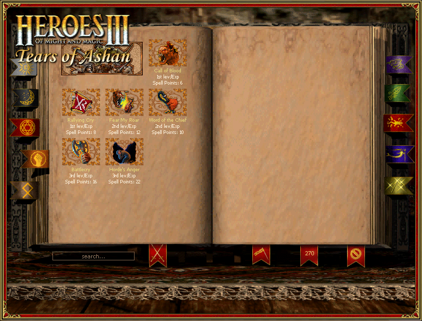

# Tears of Ashan

  

**Tears of Ashan** is a fan-made expansion for *Heroes of Might and Magic III* running on [VCMI](https://vcmi.eu/). It brings ideas, factions, heroes, spells, and mechanics from the world of Ashan into the classic Heroes III formula while preserving the pace and presentation of the original game.

The project combines the familiar foundations of Heroes III with alternate creature upgrades, expanded magic and secondary-skill systems, redesigned factions, new campaigns, and a large collection of optional gameplay and visual submods.

## Highlights

- **Alternate upgrades for every faction.** Each faction can field 21 creatures instead of 14, with two distinct upgrade paths for every base creature. Upgraded forms can be exchanged at a Hill Fort or in a town able to recruit them.
- **More tactical choice.** Alternate upgrades include offensive, defensive, and support roles, allowing armies to adapt to different opponents and battlefield situations.
- **Expanded magic.** Light Magic, Dark Magic, Warcries, Gating, Runelore, and additional spells broaden the options available to heroes.
- **Ten secondary-skill slots.** The original limit of eight has been raised to make room for the expanded skill system.
- **A rebuilt Conflux.** The four core Elementals have been rebalanced for their actual creature levels while retaining the faction's distinctive identity.
- **New and reimagined factions.** Sanctuary, Cathedral, Forge, and the Dwarven Bulwark expand the playable roster through bundled submods.
- **New heroes, artifacts, map objects, and encounters.** The adventure map and hero development systems have been expanded throughout.
- **Campaign content.** The Sanctuary campaign has been carefully adapted for the Heroes III engine.

## Alternate Upgrades

Every base creature now has two possible upgraded forms. These are intended as meaningful strategic alternatives rather than linear replacements: one may provide raw damage, another battlefield control, protection, spell support, or a different answer to a faction's weaknesses.

<table>
  <tr>
    <td width="50%"></td>
    <td width="50%"></td>
  </tr>
  <tr>
    <td align="center"><b>Castle</b></td>
    <td align="center"><b>Rebuilt Conflux</b></td>
  </tr>
</table>

## Magic and Hero Development

Tears of Ashan expands the spell and skill systems with mechanics inspired by later Heroes titles. Heroes can learn up to ten secondary skills, opening room for new schools and faction-specific paths without sacrificing the core development choices of Heroes III.

<table>
  <tr>
    <td width="50%"></td>
    <td width="50%"></td>
  </tr>
  <tr>
    <td align="center"><b>Light Magic</b></td>
    <td align="center"><b>Dark Magic</b></td>
  </tr>
  <tr>
    <td width="50%"></td>
    <td width="50%"></td>
  </tr>
  <tr>
    <td align="center"><b>Warcries</b></td>
    <td align="center"><b>Runelore</b></td>
  </tr>
</table>

## Factions

### Sanctuary

The Sanctuary from *Heroes VI* returns with an Ashan Naga army, Samurai and Monk heroes, its own artifacts, and a campaign adapted for Heroes III. Sanctuary remains a work in progress: some creature animations and siege-screen assets are currently represented by placeholders.

  

### Cathedral

Cathedral introduces a new army populated by familiar faces from *Heroes VI* and *Heroes VII*, translated into the visual and mechanical language of Heroes III.

### Forge

Forge is based on the faction presented by New World Computing at E3 in 1999, supplemented with additional content and integrated into the wider alternate-upgrade system.

### Dwarven Bulwark

The Dwarven faction from *Heroes V* replaces the original HotA Bulwark through an optional submod. This faction is still in development and currently lacks some alternate-upgrade artwork and map animations.

## Adventure Map and Campaigns

The expansion adds new locations, artifacts, encounters, and campaign material while retaining the classic Heroes III adventure-map presentation.

<table>
  <tr>
    <td width="50%"></td>
    <td width="50%"></td>
  </tr>
  <tr>
    <td width="50%"></td>
    <td width="50%"></td>
  </tr>
</table>

## Included Optional Submods

The repository contains a range of optional modules that can be enabled separately in the VCMI Launcher, including:

- Sanctuary, Cathedral, Forge, and Dwarven Bulwark factions
- boss encounters and campaign-hero compatibility
- diplomacy specialists and strong campaign heroes
- Ashan sound effects
- Heroes V and Heroes VI cursor sets
- Heroes V-style Devils
- factional neutral dragons
- dark interface mode
- muted battle-intro music
- compatibility layers for supported faction and hero submods

Some options conflict with other large gameplay overhauls or interface replacements. The VCMI Launcher displays dependencies and known conflicts from the included `mod.json` manifests.

## Screenshots

<table>
  <tr>
    <td width="50%"></td>
    <td width="50%"></td>
  </tr>
  <tr>
    <td width="50%"></td>
    <td width="50%"></td>
  </tr>
</table>

More screenshots are available in the [`screenshots`](screenshots/) directory.

## Project Status

Tears of Ashan is actively developed. Some bundled faction submods contain work-in-progress assets, and balance, compatibility, localization, and presentation continue to evolve between releases.

For additional information, feature details, and the full list of credits, visit the [Tears of Ashan website](https://sites.google.com/view/tearsofashan/home).

## Contributions and Permissions

Translations and formatting improvements are welcome. Other changes to the mod require the author's consent. Please consult the project website or contact the project author before redistributing modified content.

*Heroes of Might and Magic*, Ashan, and related names and assets belong to their respective rights holders. Tears of Ashan is a fan-made project.
