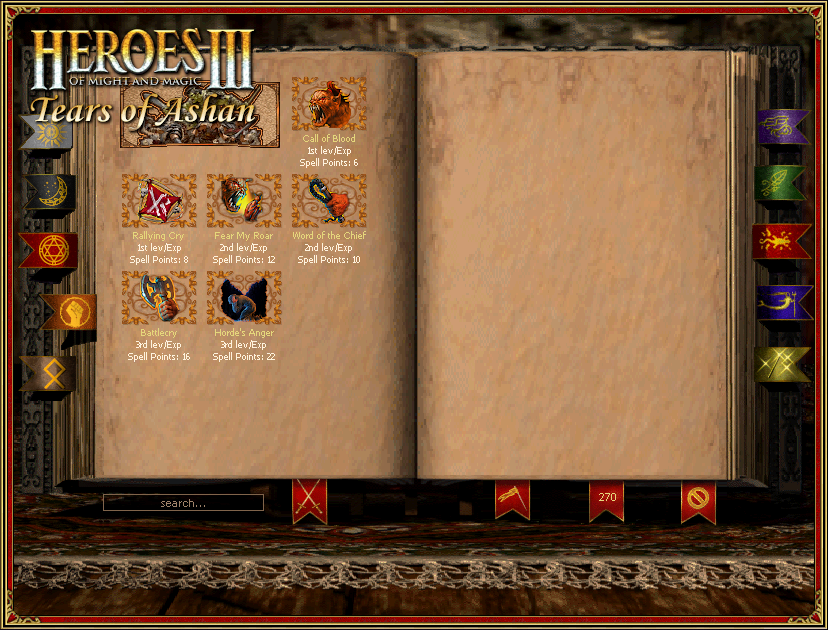
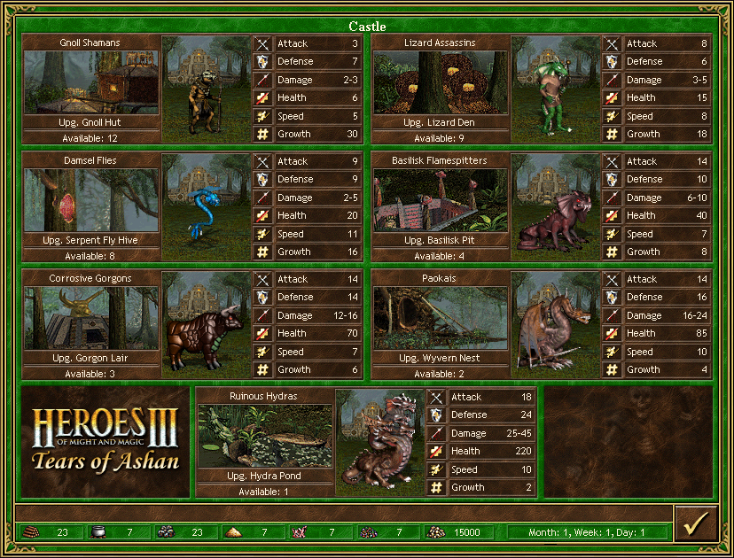
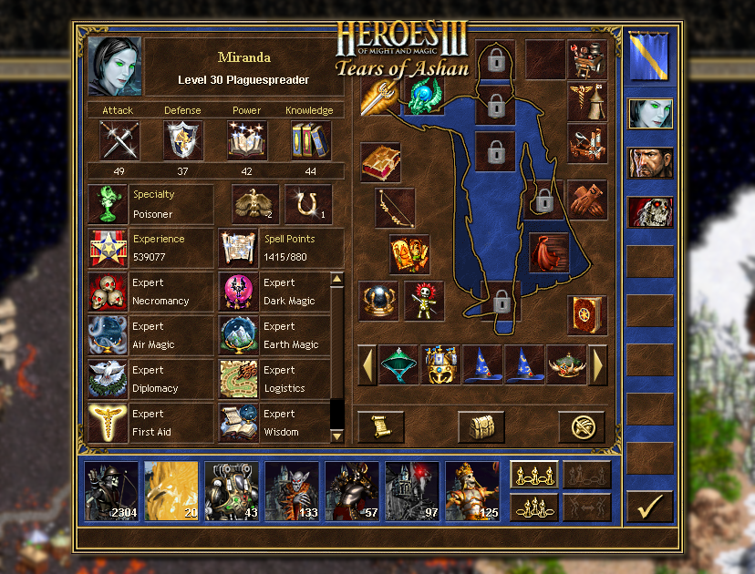
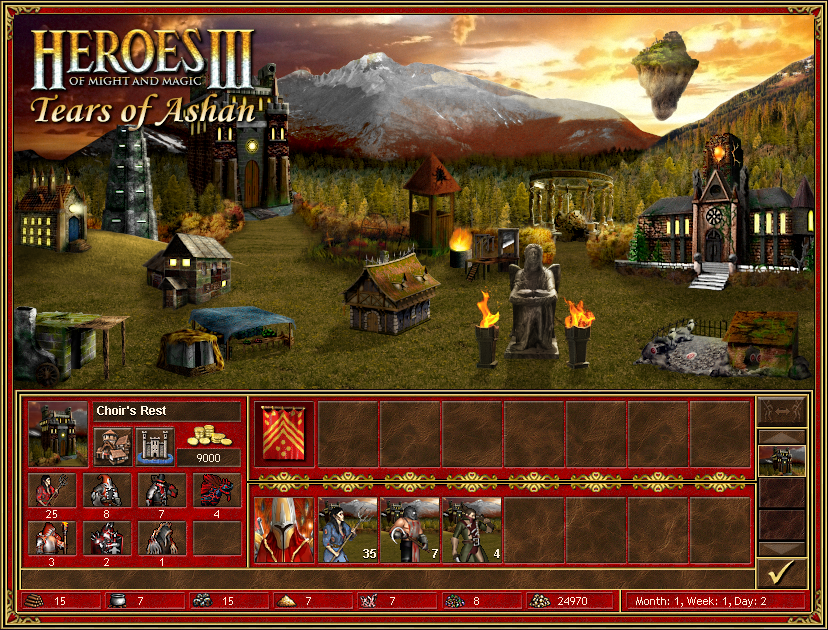
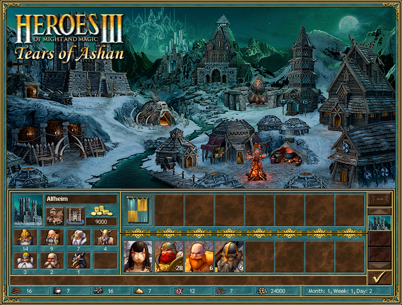

# Tears of Ashan

  

Explore a whole new realm in **Tears of Ashan**, a fan-made expansion for Heroes of Might and Magic III that mixes elements of Heroes of Might and Magic V with the familiar gameplay of Heroes III.

## Heroes III x Heroes V

**Tears of Ashan** expands upon the original game with a horde of features from **Heroes V**, such as **alternate upgrades** for every creature in every faction, **Light and Dark Magic**, and mechanics such as **Gating**.  The secondary skill cap has been raised from 8 to 10 to allow for these new skills. Explore new strategies and discover more ways to play as each creature upgrade now offers unique strategic advantages. Empower your troops with the power of holy light, or send your enemies to the netherworld as they suffocate in darkness!

<table>
  <tr>
    <td width="25%"></td>
    <td width="25%"></td>
    <td width="25%"></td>
    <td width="25%"></td>
  </tr>
  <tr>
    <td align="center"><b>Light Magic</b></td>
    <td align="center"><b>Dark Magic</b></td>
	<td align="center"><b>Warcries</b></td>
    <td align="center"><b>Runelore</b></td>
  </tr>
</table>

## Alternate Upgrades

Each faction now contains **21 creatures** instead of 14, as each creature can now choose between 2 upgrade paths. These upgraded creatures can be swapped between at any point, so long as it is done so at either a Hill Fort or a town that can recruit them. Some are supportive options that buff your troops or debuff enemy troops; some are offensive brutes that aim to take your enemies down hard and fast; and others are defensive options, there to provide cover for your shooters or bulk up your army. Each faction now has a wider set of strategies to deal with any number of situations, making adaptive gameplay even more possible!

<table>
  <tr>
    <td width="25%"></td>
	<td width="25%"></td>
	<td width="25%"></td>
    <td width="25%"></td>
  </tr>
  <tr>
    <td align="center"><b>Castle</b></td>
    <td align="center"><b>Fortress</b></td>
	<td align="center"><b>Hero Inventory</b></td>
	<td align="center"><b>Adventure Map</b></td>
  </tr>
</table>

## Conflux

While every faction has received a fair share of balance changes, the Conflux has been completely redesigned from the ground up. The core 4 Elementals are no longer "Level 3.5 units"; they have been given appropriate stats for their level while still retaining the key features that make both them and the overall balance of Conflux unique.

## Sanctuary

The Sanctuary from Heroes VI makes a return in Tears of Ashan. Lead this powerful army of Ashan Nagas into battle and discover a myriad of strategies with all-new Samurai and Monk heroes, including all those featured in the Sanctuary campaign... which is also included in this very mod. The Sanctuary campaign has been lovingly ported to Heroes III and plays (almost) as well as it does in Heroes VI, featuring a brand new set of artifacts to boot!

## Cathedral

Originally a scrapped Horn of the Abyss concept, the Cathedral has been given new life in Tears of Ashan. A dark parallel of the Castle, the Cathedral is home to all sorts of zealous heroes and creatures, hellbent on ridding the world of "evil" to the point of becoming the very thing they swore to destory. Will you heroicly lead your crusading armies to salvation? Or are you truly no better than the demons and undead you wish to vanquish?

## Crownwork

The Fortress from Heroes V is the vision of the Crownwork. Completely overriding Horn of the Abyss' Bulwark, the Crownwork features every creature present in the Heroes V Fortress, carefully adapted for Heroes III gameplay. Rune Priests and Flame Lords work together to give enemies Marks of Fire, burning them to ash whilst other creatures run rampant. With many powerful runes available to strengthen your army, let none stand in your way as you become a true monarch under the mountain! 

<table>
  <tr>
    <td width="25%"></td>
	<td width="25%"></td>
	<td width="25%"></td>
	<td width="25%"></td>
  </tr>
  <tr>
    <td align="center"><b>Conflux</b></td>
	<td align="center"><b>Sanctuary</b></td>
	<td align="center"><b>Cathedral</b></td>
	<td align="center"><b>Crownwork</b></td>
  </tr>
</table>

Read and discover more online: https://sites.google.com/view/tearsofashan

*I do not approve of any changes made to this mod without my consent. I only approve of human-made translations and formatting updates being made without my input so that the mod remains accessible to everyone.*